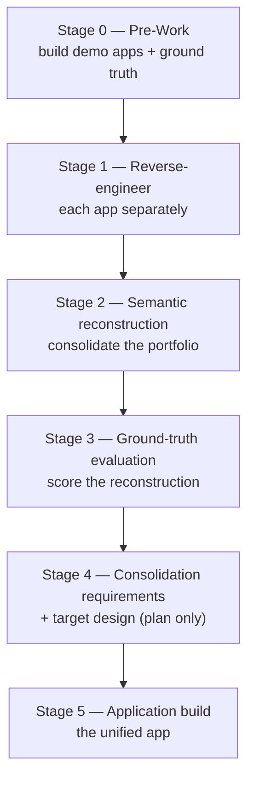

# Modernization Steps — LegacyRetailPortfolio

End-to-end record of how three separate legacy .NET 10 applications were modernized into **one
unified ASP.NET Core web application**, using a staged, AI-assisted, evidence-driven workflow.

This document links every **prompt** used to drive each stage, the **inputs** each stage consumed,
and the **artifacts** each stage produced, so the whole journey is reproducible and auditable.

---

## The starting point: three separate applications

| App | Type | Role | Source |
|-----|------|------|--------|
| **OrderDesk** | .NET 10 WPF desktop (MVVM) | Internal staff: customers, quotes, discounts, orders, returns review, agent tasks | [`src/OrderDesk`](src/OrderDesk) |
| **CustomerPortal** | ASP.NET Core MVC + Razor | Customer self-service: catalog, cart, checkout, orders, returns, tracking, support, wishlist | [`src/CustomerPortal`](src/CustomerPortal) |
| **FulfillmentAPI** | ASP.NET Core Web API | Warehouse: allocation, picking, packaging, dispatch, carrier events, return receipt, reporting | [`src/FulfillmentAPI`](src/FulfillmentAPI) |

All three shared one SQL Server database (`LegacyRetailDB`): [`database/`](database). The only shared
code was `LegacyRetail.Common` (connection config + PBKDF2) — no shared business logic.

## The end state: one unified application

A single deployable ASP.NET Core .NET 10 **modular monolith** — [`consolidated-app/`](consolidated-app)
— that preserves all 47 business capabilities across a customer storefront, a staff area, a warehouse
area, and the backward-compatible `/api/fulfillment/*` endpoints, over the same unchanged database.

---

## The staged workflow at a glance



Core principle throughout: **evidence over assumption**. Every stage cited source code / SQL / tests,
distinguished verified behavior from proposals, and preserved intentional differences rather than
collapsing them.

---

## Stage 0 — Pre-Work (set up the experiment)

Create the legacy demo portfolio and a withheld ground-truth answer key to grade the experiment later.

- **Prompts:**
  - [`Prompts/Stage 0. PreWork/01.CreateDemoApps.md`](Prompts/Stage%200.%20PreWork/01.CreateDemoApps.md) — scaffold the three apps + shared DB.
  - [`Prompts/Stage 0. PreWork/02.GroundTruthBuilder..md`](Prompts/Stage%200.%20PreWork/02.GroundTruthBuilder..md) — author the ground-truth benchmark.
- **Produced:**
  - The three applications under [`src/`](src) and the database under [`database/`](database).
  - The withheld answer key under [`benchmark/ground-truth/`](benchmark/ground-truth) (never shown to the analyzing agent during Stages 1–4).

## Stage 1 — Reverse-engineer each app separately

Independently reconstruct each app's capabilities, entities, rules, workflows, and DB dependencies
from implementation evidence only (no ground truth, no cross-app access).

- **Prompts (one per app):**
  - [`Prompts/Stage 1. ReverseEngineer-Seperately/03.OrderDesk.md`](Prompts/Stage%201.%20ReverseEngineer-Seperately/03.OrderDesk.md)
  - [`Prompts/Stage 1. ReverseEngineer-Seperately/04.CustomerPortal.md`](Prompts/Stage%201.%20ReverseEngineer-Seperately/04.CustomerPortal.md)
  - [`Prompts/Stage 1. ReverseEngineer-Seperately/05.FullfillmentAPI.md`](Prompts/Stage%201.%20ReverseEngineer-Seperately/05.FullfillmentAPI.md)
- **Produced** (per-app profiles, capability/entity/rule/workflow/dependency YAML, evidence index):
  - [`analysis-output/orderdesk/`](analysis-output/orderdesk)
  - [`analysis-output/customerportal/`](analysis-output/customerportal)
  - [`analysis-output/fulfillmentapi/`](analysis-output/fulfillmentapi)
- **Result:** 47 capabilities, 67 business rules, and full entity/dependency maps discovered across the three apps.

## Stage 2 — Semantic reconstruction (portfolio consolidation)

Consolidate the three Stage 1 analyses into one portfolio view: canonical capabilities, overlap
classification, canonical domains/entities, cross-app dependencies and workflows — verified against
source/SQL/tests.

- **Prompt:**
  - [`Prompts/Stage 2. Semenatic Reconstruction/06. SementicReconsutuction.md`](Prompts/Stage%202.%20Semenatic%20Reconstruction/06.%20SementicReconsutuction.md)
- **Produced** — [`analysis-output/portfolio/`](analysis-output/portfolio):
  - `portfolio-capabilities.yaml`, `capability-overlaps.yaml`, `canonical-domains.yaml`,
    `cross-app-dependencies.yaml`, `cross-app-workflows.yaml`, `business-rule-comparison.yaml`,
    `portfolio-architecture.md`, `evidence-index.yaml`, `unresolved-findings.md`.
- **Key findings:** shared tables with multiple C# models (Order×3, Customer×2 + distinct
  CustomerAccount); duplicated rules (mandatory-info, availability); the bounded cancellation
  divergence; data-mediated-only coupling (no direct cross-app calls).

## Stage 3 — Ground-truth evaluation

Grade the Stage 1 + Stage 2 reconstruction against the withheld benchmark with deterministic,
code-computed metrics.

- **Prompts:**
  - [`Prompts/Stage 3. GroundTruth/07.GroundTruth.md`](Prompts/Stage%203.%20GroundTruth/07.GroundTruth.md)
  - [`Prompts/Stage 3. GroundTruth/07.5GroundTruth2.md`](Prompts/Stage%203.%20GroundTruth/07.5GroundTruth2.md)
- **Benchmark used:** [`benchmark/ground-truth/`](benchmark/ground-truth)
- **Produced** — [`evaluation-output/`](evaluation-output):
  - `evaluation-summary.md`, `scorecard.yaml`, `capability-matches.yaml`, `entity-matches.yaml`,
    `business-rule-matches.yaml`, `overlap-evaluation.yaml`, `dependency-evaluation.yaml`,
    `workflow-evaluation.yaml`, `evidence-validation.yaml`, `stage-comparison.md`,
    `confusion-matrix.csv`, `false-positives.md`, `false-negatives.md`, `adjudication-queue.yaml`,
    `evaluation-methodology.md`, `evaluation-dashboard.html`, and the deterministic scorer `score.py`.
- **Result:** weighted overall **95.5%**; 100% capability/rule/entity discovery recall; the main gap
  was overlap classification (two "broadly-shared" scenarios under-classified).

## Stage 4 — Consolidation requirements & target design (planning only)

Translate the verified findings into an approved consolidation specification — no code yet.

- **Prompt:**
  - [`Prompts/Stage 4. Consolidation Requirments/08.ConsolidationRequirmentsAndTargetDesign.md`](Prompts/Stage%204.%20Consolidation%20Requirments/08.ConsolidationRequirmentsAndTargetDesign.md)
- **Produced** — [`consolidation-planning/`](consolidation-planning):
  - `unified-capability-catalog.yaml`, `capability-reconciliation.yaml`, `consolidated-domain-model.md`,
    `module-ownership-matrix.yaml`, `unified-web-requirements.md`, `api-compatibility-inventory.yaml`,
    `data-consolidation-assessment.md`, `functional-parity-matrix.yaml`, `architecture-options.md`,
    `consolidation-decisions.md`, `consolidation-readiness-report.md`.
- **Decisions:** modular monolith; 13 logical modules; keep schema + 5 stored procs; preserve the API
  contract; preserve intentional per-actor differences; every capability dispositioned (0 discarded).

## Stage 5 — Application build (the unified app)

Implement, test, and validate the consolidated application incrementally (M1 foundation → M2 API
compatibility → M3 customer web → M4 staff web → M5 warehouse web + validation).

- **Prompt:**
  - [`Prompts/Stage 5. ApplicationBuild/09.BuildTheApp.md`](Prompts/Stage%205.%20ApplicationBuild/09.BuildTheApp.md)
- **Produced** — [`consolidated-app/`](consolidated-app):
  - [`consolidated-app/src/UnifiedRetail/`](consolidated-app/src/UnifiedRetail) — the single ASP.NET Core host.
  - [`consolidated-app/tests/UnifiedRetail.Tests/`](consolidated-app/tests/UnifiedRetail.Tests) — integration + contract + workflow tests.
  - [`consolidated-app/README.md`](consolidated-app/README.md) — run/provision instructions.
  - [`consolidated-app/implementation-progress.md`](consolidated-app/implementation-progress.md) — milestone log.
  - [`consolidated-app/validation-report.md`](consolidated-app/validation-report.md) — capability + API + test validation.
- **Result:** builds clean; **27 tests pass, 0 fail, 2 skipped** (a documented activity-report
  cold-start harness flake — the endpoint itself is verified correct); all 47 capabilities implemented;
  all 15 API endpoints preserved; schema + procs unchanged.

---

## Prompt → output cross-reference

| Stage | Prompt(s) | Primary output |
|-------|-----------|----------------|
| 0 Pre-Work | `01.CreateDemoApps.md`, `02.GroundTruthBuilder..md` | [`src/`](src), [`database/`](database), [`benchmark/ground-truth/`](benchmark/ground-truth) |
| 1 Reverse-engineer | `03.OrderDesk.md`, `04.CustomerPortal.md`, `05.FullfillmentAPI.md` | [`analysis-output/orderdesk`](analysis-output/orderdesk), [`customerportal`](analysis-output/customerportal), [`fulfillmentapi`](analysis-output/fulfillmentapi) |
| 2 Semantic reconstruction | `06. SementicReconsutuction.md` | [`analysis-output/portfolio/`](analysis-output/portfolio) |
| 3 Ground-truth eval | `07.GroundTruth.md`, `07.5GroundTruth2.md` | [`evaluation-output/`](evaluation-output) |
| 4 Consolidation plan | `08.ConsolidationRequirmentsAndTargetDesign.md` | [`consolidation-planning/`](consolidation-planning) |
| 5 Application build | `09.BuildTheApp.md` | [`consolidated-app/`](consolidated-app) |

## How to run the unified application

Prerequisites: .NET 10 SDK and SQL Server LocalDB with `LegacyRetailDB` provisioned.

```powershell
# 1. (once) provision + seed a disposable local database
dotnet run --project database/provisioning/DbProvisioner/DbProvisioner.csproj

# 2. run the unified app
dotnet run --project consolidated-app/src/UnifiedRetail/UnifiedRetail.csproj --launch-profile http

# 3. run the tests
dotnet test consolidated-app/tests/UnifiedRetail.Tests/UnifiedRetail.Tests.csproj
```

Then browse `http://localhost:5280`.

Sign-in:
- **Customer storefront** — `/Account/Login`, seeded users `user1`..`user80`, password `Password123!`.
- **Staff / warehouse** — `/Account/Staff` role picker (PoC; the source WPF/API apps had no web login).
- **API** — header `X-Api-Key: dev-fulfillment-key` on `/api/fulfillment/*`.

## Other references

- Repository overview: [`README.md`](README.md)
- Additional docs: [`docs/`](docs)
- Solution file: [`LegacyRetailPortfolio.slnx`](LegacyRetailPortfolio.slnx)
