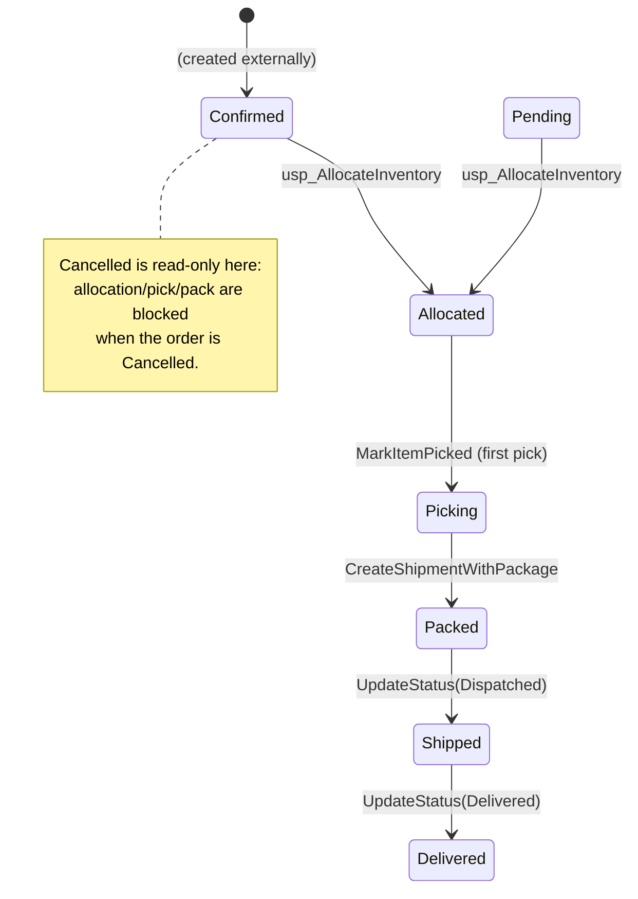
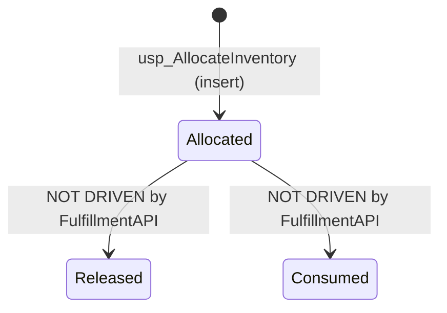
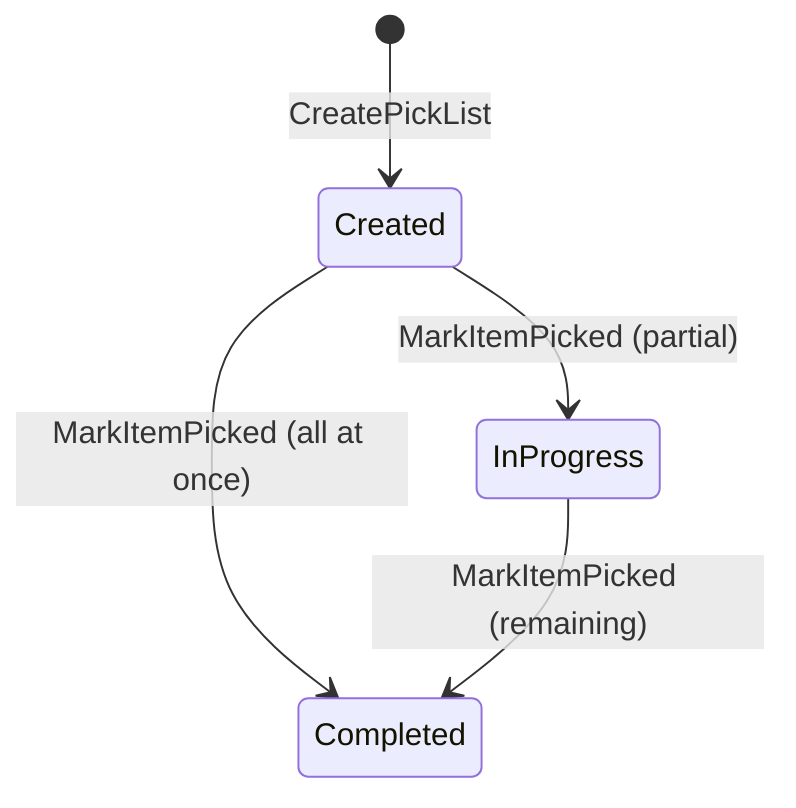
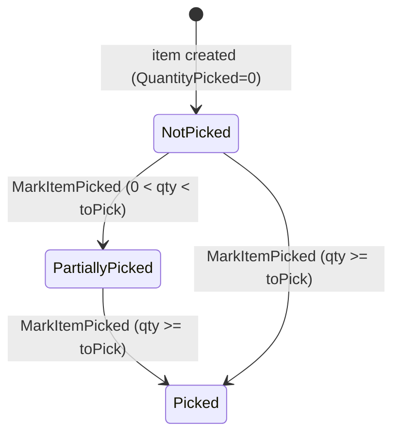
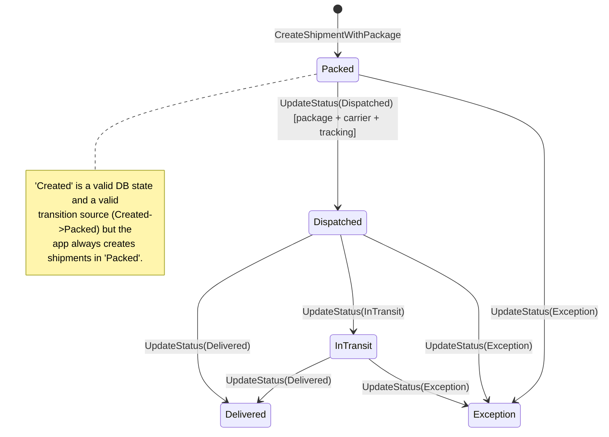
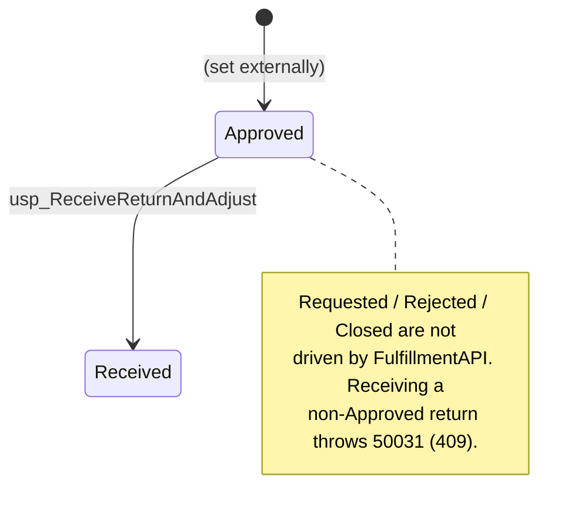
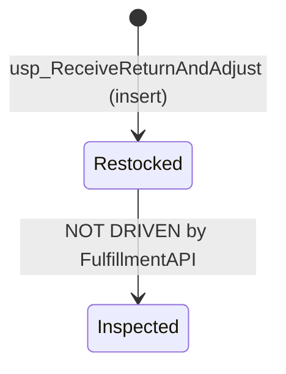

# FulfillmentAPI — State Machines (Reverse-Engineered)

State machines are reconstructed strictly from observed transitions in code and SQL. States
allowed by DB CHECK constraints but never produced by FulfillmentAPI are marked as
**not driven here** rather than inferred as active.

---

## 1. Order (fulfillment-driven subset of dbo.Orders.OrderStatus)

FulfillmentAPI does not create orders; it only advances `OrderStatus` through the
fulfillment stages. The full CHECK set is
`Pending, Confirmed, Allocated, Picking, Packed, Shipped, Delivered, Cancelled`
(`database/schema/01_schema.sql:CK_Orders_Status`), but this application only performs the
transitions below.

- Allocated: `usp_AllocateInventory` when prior status is Pending/Confirmed (FA-RULE-012).
- Picking: `PickingService.MarkItemPickedAsync` when status is Allocated (FA-RULE-013).
- Packed: `ShipmentService.CreateShipmentWithPackageAsync` (FA-RULE-014).
- Shipped: `ShipmentService.UpdateStatusAsync` on shipment Dispatched (FA-RULE-017).
- Delivered: `ShipmentService.UpdateStatusAsync` on shipment Delivered (FA-RULE-017).
- Cancelled: **not set by this app** — it only *reads* this state as a guard
  (`FulfillmentRules.IsBlockedForFulfillment`, `usp_AllocateInventory` THROW 50021).

Guards / invalid transitions:
- Allocation, pick-list creation, and packaging are all rejected when the order is Cancelled.
- No transition back to earlier states is performed by this application.

---

## 2. InventoryAllocation (dbo.InventoryAllocations.AllocationStatus)

CHECK set: `Allocated, Released, Consumed`
(`database/schema/04_fulfillment.sql:CK_InventoryAllocations_Status`).

Observed behavior: only `Allocated` is ever written (by `usp_AllocateInventory`). No code
path sets `Released` or `Consumed`.

---

## 3. PickList (dbo.PickLists.PickStatus)

CHECK set: `Created, InProgress, Completed`
(`database/schema/04_fulfillment.sql:CK_PickLists_Status`).

- Created: on `CreatePickListAsync`.
- InProgress: `MarkItemPickedAsync` when some but not all items picked.
- Completed: `MarkItemPickedAsync` when all items are picked.

(Triggered in `PickingService.MarkItemPickedAsync`, which recomputes status from item flags.)

---

## 4. PickListItem (picked flag)

`PickListItem.IsPicked` flips to true when `QuantityPicked >= QuantityToPick`
(`PickingService.MarkItemPickedAsync`). `QuantityPicked` is constrained to
`0 <= QuantityPicked <= QuantityToPick` (FA-RULE-008 / `CK_PickListItems_Qty`).

---

## 5. Shipment (dbo.Shipments.ShipmentStatus)

CHECK set: `Created, Packed, Dispatched, InTransit, Delivered, Exception`
(`database/schema/04_fulfillment.sql:CK_Shipments_Status`). Transition validity is defined
in `FulfillmentRules.IsValidShipmentTransition` (FA-RULE-015).

- Entry: shipments are **created in `Packed`** (via `CreateShipmentWithPackageAsync`); the
  schema default is `Created`, but the application never creates a shipment in `Created`.
- Packed -> Dispatched: requires package + carrier + tracking (FA-RULE-016).
- Dispatched -> InTransit -> Delivered, or Dispatched -> Delivered.
- `* -> Exception` allowed from any state.

Invalid transitions (rejected with 409): any pair not in the allowed set, e.g.
`Created->Delivered` (skip) or `Delivered->Packed` (backward). Verified by
`FulfillmentRulesTests.IsValidShipmentTransition`.

---

## 6. Return (dbo.Returns.ReturnStatus) — fulfillment-driven subset

CHECK set: `Requested, Approved, Rejected, Received, Closed`
(`database/schema/01_schema.sql:CK_Returns_Status`). FulfillmentAPI performs exactly one
transition:

- Approved -> Received: `usp_ReceiveReturnAndAdjust` (only Approved returns may be received;
  FA-RULE-019 / FA-RULE-020).

All other states (Requested, Approved, Rejected, Closed) are set outside this application.

---

## 7. ReturnReceipt (dbo.ReturnReceipts.ReceivedStatus)

CHECK set: `Received, Inspected, Restocked`
(`database/schema/04_fulfillment.sql:CK_ReturnReceipts_Status`). Observed behavior: the
procedure inserts a receipt directly in `Restocked`; `Inspected` and a standalone `Received`
value are never written by the application (the default column value is `Received`, but the
proc supplies `Restocked`). One receipt per return (UQ_ReturnReceipts_Return) enforces
idempotency (FA-RULE-021).

---

## Notes
- Diagrams show only transitions with concrete code/SQL evidence. States that exist in CHECK
  constraints but are never produced by this application are explicitly labelled
  "NOT DRIVEN by FulfillmentAPI" rather than assumed active.
- Order and Return are shared tables; their pre-fulfillment states are produced externally.
