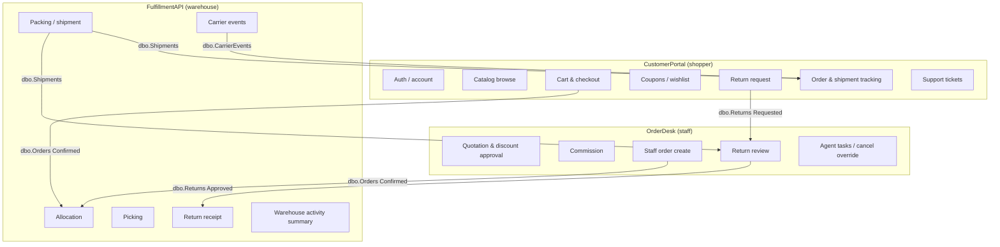
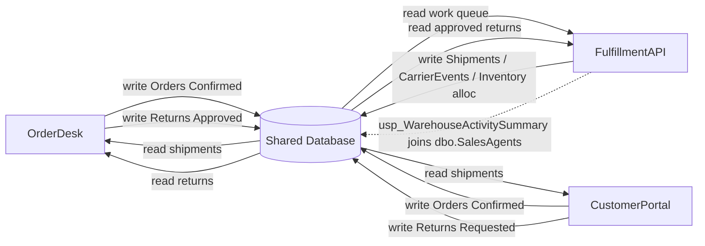
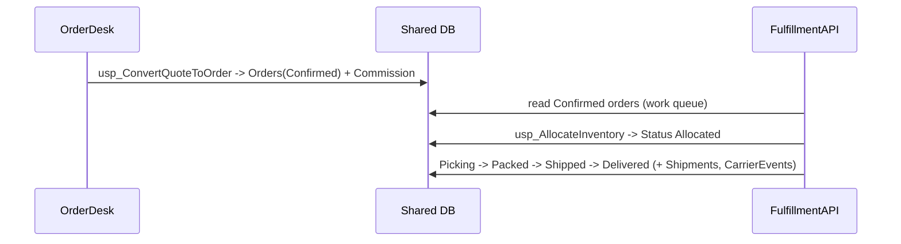
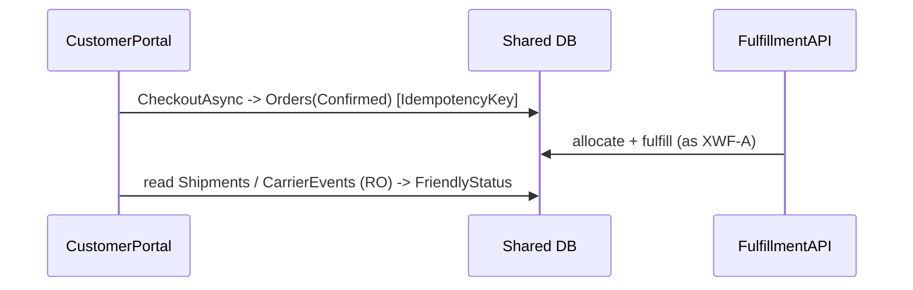
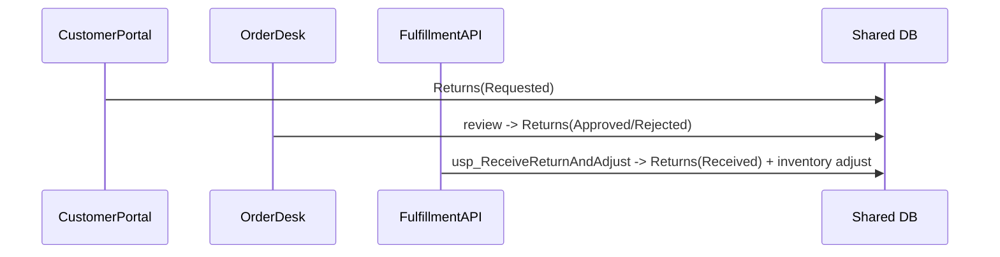

# LegacyRetailPortfolio — Consolidated Business Architecture (Stage 2)

Reconstructed as-is business architecture across the three applications of
LegacyRetailPortfolio, consolidated from the Stage 1 per-app analyses and verified in Phase B
against source, SQL DDL / stored procedures, and integration tests.

**Scope honored:** no ground-truth access, no application modification, read-only analysis, no
fabricated results, no invented relationships, no proposed target architecture. Every finding
below references Stage 1 evidence IDs and Stage 2 verification evidence (see
`evidence-index.yaml`). Uncertain items are listed in `unresolved-findings.md`.

## Applications

| Key | Application | Technology | Primary actor |
|-----|-------------|------------|---------------|
| APP-ORDERDESK | OrderDesk | .NET 10 WPF desktop | Sales / back-office staff |
| APP-PORTAL | CustomerPortal | .NET 10 ASP.NET Core MVC | Shoppers (self-service) |
| APP-FULFILL | FulfillmentAPI | .NET 10 ASP.NET Core Web API | Warehouse operations |

**Integration style:** data-mediated only. No direct code or HTTP calls between applications.
The sole shared code is `LegacyRetail.Common` (`DbConnectionConfig` + `PasswordHasher`),
which is infrastructure, not business logic. All coordination happens through shared rows in a
single shared database and their status columns.

## 1. Capability map



Shared portfolio capabilities and their overlap classification are in `capability-overlaps.yaml`
(`OVL-CUSTOMER`, `OVL-CATALOG`, `OVL-INVENTORY`, `OVL-ORDER-CREATE`, `OVL-ORDER-VIEW`,
`OVL-CANCEL`, `OVL-SHIPMENT` = partial overlaps; `OVL-RETURNS` = complementary;
`DUP-MANDATORY-INFO`, `DUP-AVAIL` = genuine duplicates).

## 2. App-to-domain responsibility matrix

Canonical domains are defined in `canonical-domains.yaml`. Legend: **W** = writes, **R** = reads,
**—** = no involvement.

| Canonical domain | OrderDesk | CustomerPortal | FulfillmentAPI |
|------------------|:---------:|:--------------:|:--------------:|
| PF-DOM-CUSTOMER (Customer & Account) | W (contact edit) | W (identity + self-service) | R |
| PF-DOM-CATALOG (Catalog & Inventory) | R | R | W (inventory) |
| PF-DOM-QUOTING (Quotation & Discount) | W | — | — |
| PF-DOM-ORDER (Order Capture & Lifecycle) | W (create/cancel) | W (create/cancel) | W (fulfillment status) |
| PF-DOM-FULFILL (Warehouse Fulfillment) | — | — | W |
| PF-DOM-SHIPMENT (Shipment & Tracking) | R | R | W |
| PF-DOM-RETURNS (Returns) | W (review) | W (request) | W (receipt) |
| PF-DOM-SHOPPING (Cart / coupons / wishlist) | — | W | — |
| PF-DOM-SUPPORT (Support tickets) | — | W | — |
| PF-DOM-SALESOPS (Sales-agent operations) | W | — | — |

## 3. Shared entity mapping

Six physical tables carry more than one application's domain model (same business concept,
different C# shape). Full detail in `canonical-domains.yaml` / `evidence-index.yaml`.

| Canonical entity | Table | OrderDesk model | CustomerPortal model | FulfillmentAPI model | Writer(s) |
|------------------|-------|-----------------|----------------------|----------------------|-----------|
| CE-ORDER | dbo.Orders | Order | CustomerOrder | FulfillmentOrder | OD, CP (create); FA (status) |
| CE-CUSTOMER | dbo.Customers | Customer | ShopperProfile (+ CustomerAccount 1:1) | — (read in report) | OD, CP |
| CE-INVENTORY | dbo.Inventory | InventoryItem | StockLevel | StockRecord | FA |
| CE-RETURN | dbo.Returns | ReturnRequest | CustomerReturn | ReturnForReceipt | CP, OD, FA (by stage) |
| CE-SHIPMENT | dbo.Shipments | ShipmentStatusView (RO) | TrackedShipment (RO) | Shipment (writer) | FA |
| CE-CARRIER-EVENT | dbo.CarrierEvents | — | TrackingEvent (RO) | CarrierEvent (writer) | FA |

## 4. Cross-app dependency diagram

Dependencies are defined in `cross-app-dependencies.yaml`.



- **DEP-ORDER-HANDOFF** (OD, CP → FA) — order creation handed to fulfillment via `dbo.Orders`
  status. *behavior_verified* (WorkflowA, WorkflowD).
- **DEP-SHIPMENT-READ** (FA → CP, OD) — read-only shipment/carrier-event visibility.
  *behavior_verified* (shipment visibility test).
- **DEP-RETURN-LIFECYCLE** (CP → OD → FA) — staged return ownership. *behavior_verified* (WorkflowC).
- **DEP-REPORT-JOIN** — FA's `usp_WarehouseActivitySummary` reads OrderDesk-owned `dbo.SalesAgents`
  via `Orders.PlacedByAgentId`. *source_verified*.

## 5. Cross-app workflow diagrams

Workflows are defined in `cross-app-workflows.yaml`.

### XWF-A — Staff quote → order → fulfillment *(behavior_verified)*



### XWF-B — Customer checkout → fulfillment → tracking *(source_verified; see H-1)*



### XWF-C — Return request → review → receipt *(behavior_verified)*



### XWF-D — Cancellation blocks fulfillment *(behavior_verified)*

```mermaid
sequenceDiagram
  participant Actor as OrderDesk or CustomerPortal
  participant DB as Shared DB
  participant FA as FulfillmentAPI
  Actor->>DB: set Orders.Status = Cancelled
  FA->>DB: usp_AllocateInventory on cancelled order
  DB-->>FA: THROW 50021 (allocation blocked)
```

## 6. Unique capabilities (per app)

- **OrderDesk:** quotations, discount approval, sales commission, sales-agent tasks,
  cancellation override with audit.
- **CustomerPortal:** authentication/account, cart, coupons/promotions, wishlist, support tickets.
- **FulfillmentAPI:** warehouses/bins, inventory allocation, picking, packaging, carrier events,
  return receipt, warehouse activity summary.

## 7. Verified overlaps

- **Partial overlaps** (same table, different workflow/validation/effect): customer management,
  catalog browse, inventory availability, order create, order view, cancellation, shipment
  visibility. See `OVL-*` in `capability-overlaps.yaml`.
- **Complementary** (distinct sequential stages of one lifecycle): returns (`OVL-RETURNS`),
  idempotency mechanisms (`RULE-IDEMPOTENCY`).
- **Genuine duplicates:** mandatory-customer-info guard (identical predicate in 3 places,
  `DUP-MANDATORY-INFO` / `RULE-MANDATORY-INFO`) and the availability expression
  `OnHand - Allocated` (`DUP-AVAIL`, expression-level only).
- **Bounded rule divergence:** cancellation (`RULE-CANCEL`) — OrderDesk allows cancel from
  `Allocated` (override + audit), CustomerPortal only from Pending/Confirmed. *behavior_verified*.

## 8. Unresolved questions

See `unresolved-findings.md`. Summary:
- XWF-B is not covered end-to-end by a single cross-app test (H-1).
- Authoritative creator of base Product / SalesAgent master data not located in the three apps (H-2).
- Column-level provenance of return-line detail across apps not exhaustively traced (H-3).

## Artifact index

| File | Contents |
|------|----------|
| `portfolio-capabilities.yaml` | Consolidated portfolio capability catalog |
| `capability-overlaps.yaml` | Overlap/duplicate classification per shared capability |
| `canonical-domains.yaml` | Canonical domains + shared entity → app-model mapping |
| `cross-app-dependencies.yaml` | Data-mediated dependencies between apps |
| `cross-app-workflows.yaml` | End-to-end multi-app workflows (XWF-A..D) |
| `business-rule-comparison.yaml` | Rule-by-rule reconciliation + classification |
| `evidence-index.yaml` | Stage 1 ID → Stage 2 verification evidence map |
| `portfolio-architecture.md` | This document |
| `unresolved-findings.md` | Hypotheses, gaps, deliberately-not-asserted items |
