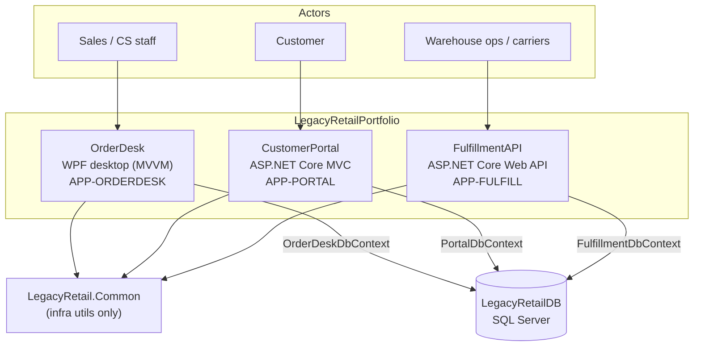
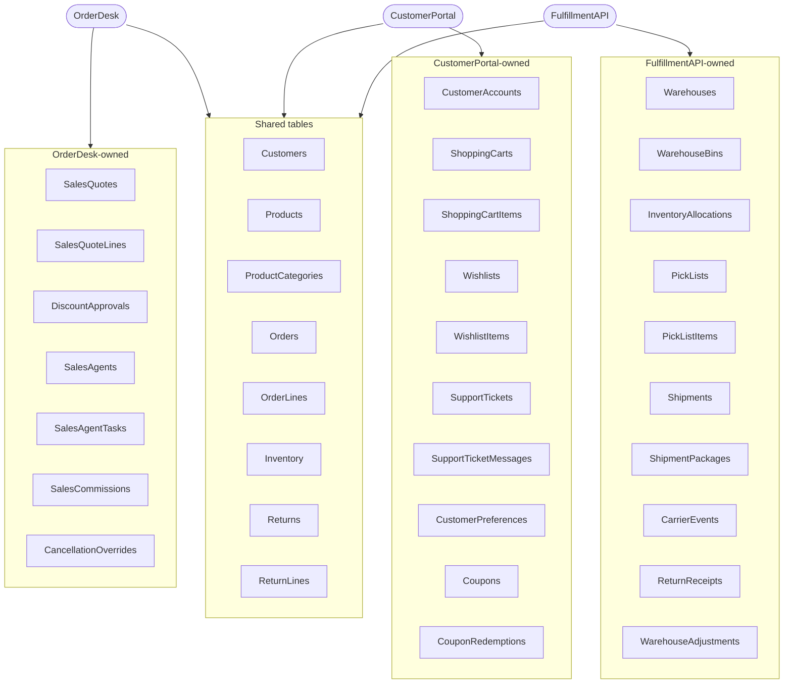
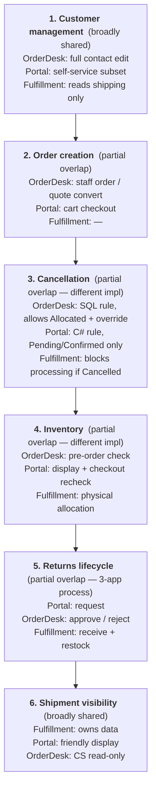
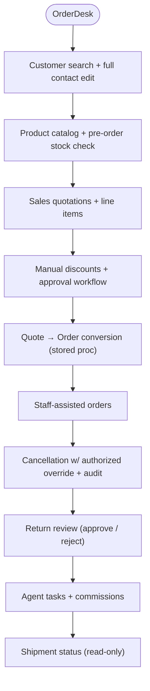
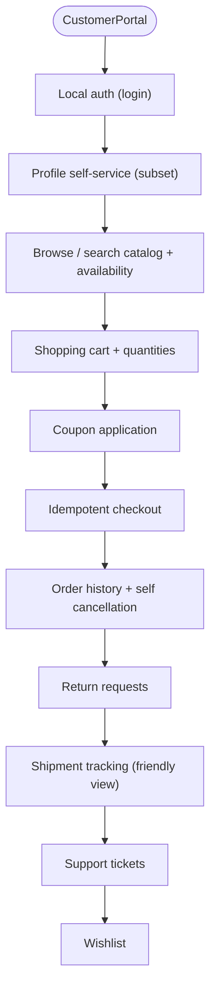
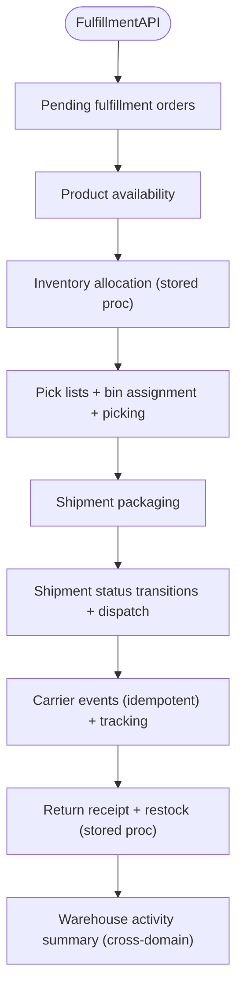
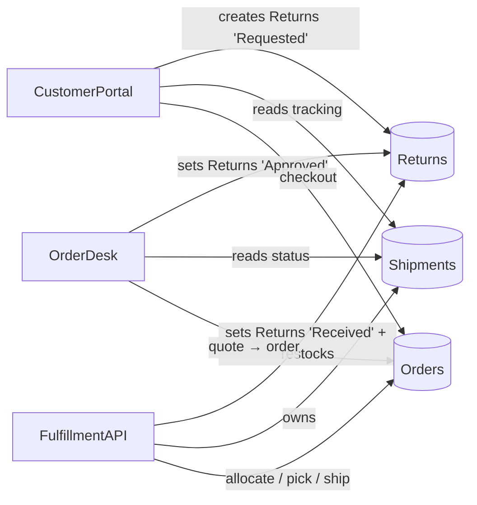

# Application Architecture (Ground Truth)

> **Benchmark artifact.** Derived from the other ground-truth files
> (`application-inventory.md`, `business-capabilities.yaml`, `capability-overlaps.yaml`,
> `domain-entities.yaml`). Describes each application's functionality, the features that
> overlap between applications, and the exact database tables each application uses.
> Keep this folder **withheld** from the analyzing agent during experiments.

---

## 1. Portfolio overview

Three independently deployable .NET 10 applications share one SQL Server database
(`LegacyRetailDB`). Each app owns its domain model, EF Core `DbContext`, services, and
business rules. The only shared code is `LegacyRetail.Common` (connection-string +
PBKDF2 hashing infrastructure — no business logic, no entities).

### The applications at a glance

- **OrderDesk** (`APP-ORDERDESK`) — an internal **WPF desktop** application (MVVM) used by
  sales reps and customer-service staff. It is the back-office tool for the sales side of
  the business: searching and editing customers, building sales quotations, approving
  manual discounts, converting approved quotes into orders, placing staff-assisted orders,
  cancelling orders (with an authorized-override audit trail), reviewing customer returns,
  and tracking agent tasks and commissions. Several of its rules are enforced in SQL
  stored procedures.

- **CustomerPortal** (`APP-PORTAL`) — a customer-facing **ASP.NET Core MVC** web
  application for self-service shopping. Customers sign in, browse and search the catalog,
  manage a shopping cart, apply coupons, check out (idempotently), view their order
  history, request cancellations and returns, follow shipment tracking in a friendly view,
  manage a wishlist, and raise support tickets. It enforces its own, generally stricter,
  customer-facing rules in C#.

- **FulfillmentAPI** (`APP-FULFILL`) — a warehouse-facing **ASP.NET Core Web API**
  (controllers + Swagger, API-key auth) that executes physical fulfilment: listing pending
  orders, allocating inventory, generating pick lists and recording picking, packaging and
  dispatching shipments, recording carrier tracking events, receiving returned merchandise
  (with restock), and reporting cross-domain warehouse activity. It processes orders from
  **both** OrderDesk and CustomerPortal and owns the shipment and allocation data the other
  apps read.

Together they form a single retail business process that spans the three apps: a sale is
created in OrderDesk or CustomerPortal, fulfilled by FulfillmentAPI, and any return travels
Portal → OrderDesk → FulfillmentAPI.

---

## 2. Database tables used by each application

`LegacyRetailDB` is one physical schema. Tables are **logically** owned by an app, but
some are read and/or written across app boundaries. Legend:
**O** = owns/primary writer · **W** = writes · **R** = reads.

### OrderDesk — tables used
*DbContext: `OrderDesk.Infrastructure.OrderDeskDbContext` · model: `src/OrderDesk/OrderDesk.Domain/Entities.cs`*

| Table | Access | C# model | Notes |
|-------|--------|----------|-------|
| Customers | R/W | `Customer` | Full staff contact + shipping edit |
| Products | R | `Product` | |
| ProductCategories | R | `ProductCategory` | |
| Inventory | R | `InventoryItem` | Pre-order availability check |
| Orders | R/W | `Order` | Staff orders, cancellation |
| OrderLines | R/W | `OrderLine` | |
| Returns | R/W | `ReturnRequest` | Approve / reject |
| Shipments | R | `ShipmentStatusView` | Read-only (FulfillmentAPI owns) |
| SalesQuotes | **O** | `SalesQuote` | |
| SalesQuoteLines | **O** | `SalesQuoteLine` | |
| DiscountApprovals | **O** | `DiscountApproval` | |
| SalesAgents | **O** | `SalesAgent` | |
| SalesAgentTasks | **O** | `SalesAgentTask` | |
| SalesCommissions | **O** | `SalesCommission` | Written by `usp_ConvertQuoteToOrder` |
| CancellationOverrides | **O** | `CancellationOverride` | Override audit trail |

### CustomerPortal — tables used
*DbContext: `CustomerPortal.Infrastructure.PortalDbContext` · model: `src/CustomerPortal/CustomerPortal.Domain/Entities.cs`*

| Table | Access | C# model | Notes |
|-------|--------|----------|-------|
| Customers | R/W | `ShopperProfile` | Self-service subset (2nd model over this table) |
| Products | R | `CatalogProduct` | |
| ProductCategories | R | `Category` | |
| Inventory | R | `StockLevel` | Display + checkout recheck |
| Orders | R/W | `CustomerOrder` | Checkout, self cancellation (2nd model over this table) |
| OrderLines | R/W | `CustomerOrderLine` | |
| Returns | R/W | `CustomerReturn` | Create requests |
| ReturnLines | R/W | `CustomerReturnLine` | |
| Shipments | R | `TrackedShipment` | Read-only tracking |
| CarrierEvents | R | `TrackingEvent` | Read-only tracking |
| CustomerAccounts | **O** | `CustomerAccount` | Login identity (1:1 with Customers) |
| CustomerPreferences | **O** | `CustomerPreference` | |
| ShoppingCarts | **O** | `ShoppingCart` | |
| ShoppingCartItems | **O** | `ShoppingCartItem` | |
| Wishlists | **O** | `Wishlist` | |
| WishlistItems | **O** | `WishlistItem` | |
| Coupons | **O** | `Coupon` | |
| CouponRedemptions | **O** | `CouponRedemption` | |
| SupportTickets | **O** | `SupportTicket` | |
| SupportTicketMessages | **O** | `SupportTicketMessage` | |

### FulfillmentAPI — tables used
*DbContext: `FulfillmentAPI.Infrastructure.FulfillmentDbContext` · model: `src/FulfillmentAPI/FulfillmentAPI.Domain/Entities.cs`*

| Table | Access | C# model | Notes |
|-------|--------|----------|-------|
| Orders | R/W | `FulfillmentOrder` | Status rolls forward during fulfillment (3rd model over this table) |
| OrderLines | R | `FulfillmentOrderLine` | |
| Inventory | R/W | `StockRecord` | Allocation + restock |
| Returns | R/W | `ReturnForReceipt` | Receipt sets status `Received` |
| Customers | R | — (shipping fields) | Reads shipping address only |
| Warehouses | **O** | `Warehouse` | |
| WarehouseBins | **O** | `WarehouseBin` | |
| InventoryAllocations | **O** | `InventoryAllocation` | Written by `usp_AllocateInventory` |
| PickLists | **O** | `PickList` | |
| PickListItems | **O** | `PickListItem` | |
| Shipments | **O** | `Shipment` | |
| ShipmentPackages | **O** | `ShipmentPackage` | |
| CarrierEvents | **O** | `CarrierEvent` | |
| ReturnReceipts | **O** | `ReturnReceipt` | Written by `usp_ReceiveReturnAndAdjust` |
| WarehouseAdjustments | **O** | `WarehouseAdjustment` | |

---

## 3. Overlapping features

The same capability matrix at a glance — which app does what for each shared/overlapping
concept, and the overlap type:

| Scenario | OrderDesk | CustomerPortal | FulfillmentAPI | Overlap type |
|----------|-----------|----------------|----------------|--------------|
| Customer management | Full contact edit | Self-service subset | Reads shipping only | broadly shared |
| Order creation | Staff order / quote convert | Cart checkout | — | partial |
| Cancellation | SQL rule (allows `Allocated`) + override | C# rule (`Pending`/`Confirmed` only) | Blocks cancelled orders | partial, different impl |
| Inventory | Pre-order check | Display + checkout recheck | Physical allocation | partial, different impl |
| Returns | Approve / reject | Request | Receive + restock | partial (3-app process) |
| Shipment visibility | CS read-only | Friendly display | Owns data | broadly shared |

Overlap is partial and deliberate. The same concept is handled by different apps with
different responsibilities and, in several cases, different implementations
(see `capability-overlaps.yaml`).

> Each block lists the three applications' responsibilities for that capability, stacked
> top-to-bottom. The arrows only order the scenarios for readability; they are not data flow.

---

## 4. Application functionality (block diagram)

Each application is shown as its own vertical column of capabilities.

**OrderDesk (`APP-ORDERDESK`) — internal staff**

**CustomerPortal (`APP-PORTAL`) — self-service web**

**FulfillmentAPI (`APP-FULFILL`) — warehouse**

> The arrows stack each app's capabilities into a single vertical column for readability;
> they indicate a typical usage order, not strict data flow.

---

## 5. Tables with multiple C# models (intentional)

| Physical table | OrderDesk | CustomerPortal | FulfillmentAPI |
|----------------|-----------|----------------|----------------|
| `Customers` | `Customer` | `ShopperProfile` (+ `CustomerAccount` 1:1) | — (reads shipping) |
| `Orders` | `Order` | `CustomerOrder` | `FulfillmentOrder` |

These different models over one table — along with naming differences
(`Order`/`CustomerOrder`/`FulfillmentOrder`, `Customer`/`CustomerAccount`) — are
documented as intentional benchmark traps in `evidence-map.yaml`.

---

## 6. Cross-application table dependencies (summary)

See `dependencies.yaml` for the full code + stored-procedure dependency map and
`cross-app-workflows.yaml` for the end-to-end workflows these dependencies enable.
