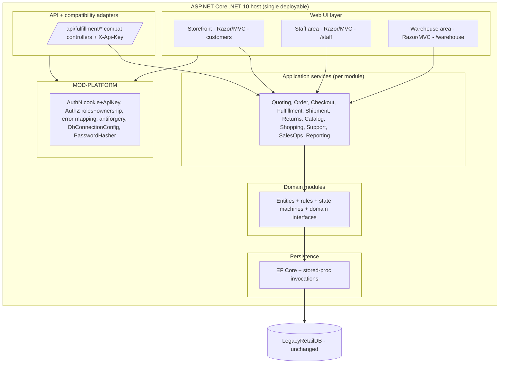

# Recommended Implementation Architecture — LegacyRetailPortfolio (planning)

A pragmatic ASP.NET Core .NET 10 architecture for consolidating OrderDesk + CustomerPortal +
FulfillmentAPI into one application. Recommendation: **modular monolith**. Microservices are explicitly
not recommended at this stage (no evidence justifies separate deployables; the apps already share one
database and coupling is data-mediated).

Tier: **[verified]** existing fact; **[proposed]** target decision; alternatives documented per section.

## 1. Recommended shape: modular monolith

One deployable ASP.NET Core host exposing three surfaces over a shared set of domain modules:

### Why modular monolith [proposed, evidence-backed]
- [verified] The three apps already run against **one** database; there is no network boundary to
  preserve and no independent scaling signal in the findings.
- [verified] Coupling is **data-mediated only** (no direct code/API calls between apps), so merging
  into one process removes accidental DB-as-integration-bus coupling without needing message infra.
- Shared commerce concepts (Customer, Order, Inventory, Returns, Shipment) are used by all three apps;
  a monolith lets them share one domain model with enforced module boundaries, which is simpler and
  safer than distributed transactions across services.
- The existing stored-proc transaction boundaries (convert, allocate, receive) are single-database;
  splitting into services would turn them into distributed transactions — a regression.

## 2. Web UI layer [proposed]
- Razor Pages or MVC + Razor views (CustomerPortal already uses MVC/Razor — lowest-friction path).
- Three route areas: storefront `/`, staff `/staff`, warehouse `/warehouse`.
- Cookie authentication for interactive users; antiforgery on state-changing POSTs (preserves CP-RULE-023).
- Alternative: SPA (React/Blazor) front end. Tradeoff: more rewrite, no functional benefit for parity;
  **not recommended** for phase 1.

## 3. API and compatibility adapters [proposed]
- Preserve the 15 `/api/fulfillment/*` endpoints verbatim (routes, verbs, DTOs, status codes, `{error}`
  + problem+json, `X-Api-Key`) via thin compatibility controllers calling the SAME application services
  the warehouse UI uses (see `api-compatibility-inventory.yaml`).
- `X-Api-Key` middleware scoped to the `/api/fulfillment/*` path prefix; cookie auth for everything else.
- Alternative: expose a new unified API and deprecate the old. Tradeoff: breaks unknown consumers;
  **not recommended** until OPEN-Q-CONSUMERS is resolved.

## 4. Application services [proposed]
- One application-service layer per module, reusing the existing service logic (CheckoutService,
  OrderService, AllocationService, etc.) with minimal change.
- Cross-module calls go through published interfaces (domain interfaces in `consolidated-domain-model.md`
  §6), not direct `DbContext` reach-through.

## 5. Domain modules [proposed]
- 13 modules per `module-ownership-matrix.yaml`. Each owns its tables, entities, rules, and (where
  applicable) stored-proc invocation.
- Multi-model tables keep distinct domain concepts (Order aggregate; CustomerAccount vs Customer).

## 6. Persistence architecture [proposed — see DEC-PERSISTENCE]
- Option A (recommended): **one `DbContext`** with per-module `IEntityTypeConfiguration` groupings.
  Pros: single mapping of each shared table (no conflicting configs), one transaction scope for
  cross-module workflows. Cons: large context; needs discipline to keep module configs separate.
- Option B: **retain per-module DbContexts** over the same connection. Pros: strong compile-time
  module isolation, closest to today. Cons: shared tables mapped by multiple contexts (the EF-conflict
  migration risk in `data-consolidation-assessment.md §5`); cross-context transactions need care.
- Either way: keep all stored procs; keep all constraints/unique indexes.

## 7. Authentication / authorization [proposed]
- Cookie auth (interactive) + `X-Api-Key` (legacy API). PBKDF2 via `LegacyRetail.Common.PasswordHasher`
  (unchanged).
- Role-based policies (DEC-ROLES) + record-ownership checks (CP-RULE-014) as a shared authZ service in
  MOD-PLATFORM.
- **Security decision (OPEN-Q-SEC):** API-key is "dev-only" per source; production hardening is a
  stakeholder decision and may be addressed without breaking the route/auth-header contract (e.g. real
  key management, network restriction) — flagged, not assumed.

## 8. Integration patterns [proposed]
- In-process module-to-module calls via interfaces. No message bus in phase 1 (no evidence of async
  needs; all workflows are synchronous DB-mediated today).
- Shared status transitions on `Orders`/`Returns` exposed as explicit domain operations so module
  boundaries are not bypassed.

## 9. Module boundaries [proposed]
- Read across modules via query interfaces; write only through the owning module's service.
- Enforce with: project/folder-per-module, internal visibility, and an architecture test (e.g.
  NetArchTest) asserting no module writes another module's tables directly.

## 10. Testing strategy [proposed]
- **Preserve** existing suites (OrderDesk/CustomerPortal/Fulfillment workflow + rules tests,
  CrossAppWorkflowTests).
- **Contract tests** for all 15 API endpoints BEFORE refactoring internals (freeze the external shape).
- **Parity tests** per `functional-parity-matrix.yaml` for behaviors lacking current coverage.
- **Architecture tests** for module-boundary rules.
- **End-to-end** test closing Stage 3 H-1 (WF-B checkout→fulfill→track in one cross-app test).

## 11. Alternatives considered (and rejected for phase 1)
| Option | Verdict | Reason |
|--------|---------|--------|
| Microservices (one service per former app) | Rejected | Reintroduces distributed transactions over shared data; no scaling/ownership evidence. |
| Keep three apps, add a gateway | Rejected | Does not meet the "one application" objective; leaves duplication. |
| Big-bang schema merge | Rejected | High risk, no clear benefit; violates "minimize DB change". |
| SPA rewrite of all UIs | Rejected (phase 1) | Pure cost, no parity benefit; MVC/Razor reuse is cheaper. |

## 12. Phasing [proposed]
1. Stand up the host + MOD-PLATFORM + persistence + API compatibility layer (contract tests green).
2. Port warehouse (FulfillmentAPI) services behind both API and new warehouse UI.
3. Port customer storefront (CustomerPortal) and staff (OrderDesk) UIs.
4. Centralize the duplicated expression/guard (RECON-AVAIL-EXPR, RECON-MANDATORY) once parity is proven.
5. Optional later phase: revisit SQL-side duplicates and any table-merge optimizations.
