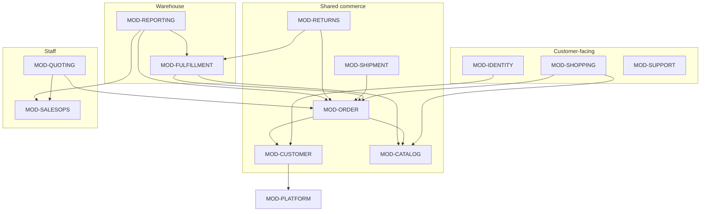

# Consolidated Domain Model — LegacyRetailPortfolio (planning)

Target: a single ASP.NET Core .NET 10 modular monolith. This document defines the canonical
business concepts, the domain modules and their boundaries, entity ownership, shared-data handling,
required domain interfaces, transaction boundaries, and database migration considerations.

Evidence base: Stage 2 `canonical-domains.yaml`, `cross-app-dependencies.yaml`; Stage 1 entity
catalogs; Stage 3 evaluation (which confirmed the entity + multi-model mapping was reconstructed
correctly, including keeping `CustomerAccount` distinct from `Customer`).

Legend for claims: **[verified]** reconstructed/confirmed in Stage 1-3; **[proposed]** target design
decision in this document.

## 1. Guiding principles

1. **One physical schema, many modules.** [proposed] The existing single `LegacyRetailDB` is retained;
   modules map only the tables they own/use, mirroring the current per-app `DbContext` discipline.
2. **Do not auto-merge C# models that share a table.** [verified trap] `Orders` has three models
   (`Order`/`CustomerOrder`/`FulfillmentOrder`) and `Customers` has two (`Customer`/`ShopperProfile`)
   plus a distinct `CustomerAccount`. These encode real per-context differences; the target keeps the
   business distinctions even while unifying the persistence mapping.
3. **One owning module per table** (write authority). [proposed] Cross-module writes to shared tables
   go through the owning module's domain service, not ad-hoc `DbContext` writes.
4. **Preserve intentional divergence.** [verified] Bounded cancellation divergence, staff-vs-customer
   edit scope, and OrderSource stamping are business facts to carry forward, not defects to normalize.

## 2. Canonical business concepts

| Canonical concept | Physical table | Former per-app models | Target treatment |
|-------------------|----------------|------------------------|------------------|
| Customer | `Customers` | `Customer` (OD, full), `ShopperProfile` (CP, subset) | One `Customer` aggregate; two update policies (staff full / self-service subset). |
| Customer Account (login) | `CustomerAccounts` | `CustomerAccount` (CP) | **Distinct** identity entity, 1:1 to Customer via `CustomerId`. Not merged into Customer. [verified trap] |
| Order | `Orders` | `Order` (OD), `CustomerOrder` (CP), `FulfillmentOrder` (FA) | One `Order` aggregate; `OrderSource` retained; lifecycle status owned jointly (capture by Order module, warehouse roll-forward by Fulfillment). |
| Order Line | `OrderLines` | 3 line models | One `OrderLine`. |
| Inventory | `Inventory` | `InventoryItem`(OD,R), `StockLevel`(CP,R), `StockRecord`(FA,R/W) | One `InventoryItem`; computed `Available = OnHand - Allocated` centralized; only Fulfillment writes. |
| Product / Category | `Products` / `ProductCategories` | `Product`/`CatalogProduct`, `ProductCategory`/`Category` | One `Product`, one `Category` (read-mostly; base rows seeded externally). |
| Return | `Returns` | `ReturnRequest`(OD), `CustomerReturn`(CP), `ReturnForReceipt`(FA) | One `Return` aggregate with a lifecycle state machine. |
| Shipment / Carrier Event | `Shipments` / `CarrierEvents` | `Shipment`(FA writer), `TrackedShipment`/`ShipmentStatusView` (CP/OD read), `CarrierEvent`/`TrackingEvent` | One writer (Fulfillment); read projections for customer (friendly) + staff (raw). |

App-owned concepts with no cross-app model (kept whole in their module): SalesQuote, DiscountApproval,
SalesAgent/Task, SalesCommission, CancellationOverride (OrderDesk); Cart, Coupon, Wishlist, SupportTicket,
CustomerPreference (CustomerPortal); Warehouse, Bin, InventoryAllocation, PickList, ShipmentPackage,
ReturnReceipt, WarehouseAdjustment (FulfillmentAPI).

## 3. Domain modules and boundaries

13 modules (see `module-ownership-matrix.yaml` for the table/capability/proc assignments):

Boundary rule [proposed]: a module may **read** another module's data through a published query
interface, but may only **write** another module's owned table through that module's domain service.

## 4. Entity ownership (write authority)

See `module-ownership-matrix.yaml#table_ownership` for the complete 40-table map. Shared-write tables
and their owners:

- `Orders` / `OrderLines` — owned by **MOD-ORDER**. Writers: MOD-ORDER (capture/cancel), MOD-QUOTING
  (via `usp_ConvertQuoteToOrder`), MOD-FULFILLMENT (status roll-forward only). [verified]
- `Inventory` — owned by **MOD-FULFILLMENT** (allocation/restock); read by MOD-CATALOG, MOD-ORDER. [verified]
- `Returns` / `ReturnLines` — owned by **MOD-RETURNS** across all lifecycle stages. [verified]
- `CouponRedemptions` — owned by **MOD-SHOPPING**; also written during checkout (MOD-ORDER) in the
  same transaction. [verified]

## 5. Shared data dependencies

[verified] From `cross-app-dependencies.yaml`: the only coupling between former apps was **data-mediated**
through the shared DB — there were no direct code/API calls. In the monolith these become in-process
module calls. The cross-domain report join (`usp_WarehouseActivitySummary` reaching OrderDesk-owned
`SalesAgents`) becomes an intra-app read.

[proposed] To keep boundaries honest inside one process, shared status transitions on `Orders` are
exposed as explicit domain operations:
- `IOrderWriteService.MarkConfirmed/Cancel` (MOD-ORDER)
- `IFulfillmentStatusService.Advance(orderId, toStatus)` (MOD-FULFILLMENT) — the only path for
  Allocated/Picking/Packed/Shipped/Delivered.

## 6. Required domain interfaces (proposed)

| Interface | Owner | Consumers | Purpose |
|-----------|-------|-----------|---------|
| `ICatalogQuery` | MOD-CATALOG | ORDER, QUOTING, SHOPPING | Non-discontinued product reads + `Available` projection. |
| `IInventoryAvailability` | MOD-CATALOG | ORDER, QUOTING | Read-only `OnHand - Allocated` (shared expression, RECON-AVAIL-EXPR). |
| `IInventoryAllocation` | MOD-FULFILLMENT | RETURNS | The only mutating inventory path (`usp_AllocateInventory`, restock). |
| `IOrderWriteService` | MOD-ORDER | QUOTING, SHOPPING | Create/cancel orders; stamp `OrderSource`. |
| `IOrderQuery` | MOD-ORDER | all | Scoped reads: All / OwnedBy(customerId) / WorkQueue (RECON-ORDER-VIEW). |
| `IFulfillmentStatusService` | MOD-FULFILLMENT | — | Order status roll-forward during fulfillment. |
| `IShipmentTracking` | MOD-SHIPMENT | CUSTOMER views, STAFF views | Read tracking; friendly vs raw adapters. |
| `ICustomerDirectory` | MOD-CUSTOMER | ORDER, QUOTING, REPORTING | Customer lookup + mandatory-info guard (RECON-MANDATORY). |

## 7. Transaction boundaries

[verified] Existing transactional units to preserve exactly:
- `usp_ConvertQuoteToOrder` — quote→order + commission in one tx (UPDLOCK/HOLDLOCK, convert-once).
- `usp_AllocateInventory` — per-order allocation; `XACT_ABORT` rollback on over-allocation (50022) /
  cancelled (50021).
- `usp_ReceiveReturnAndAdjust` — receipt + restock + adjustment + status in one tx; idempotent.
- CustomerPortal checkout — order + lines + coupon redemption + cart close in one tx; idempotency key.

[proposed] Target rule: keep each of these as a single transaction owned by its module. Cross-module
workflows (e.g. returns receipt restocking inventory) run inside the owning stored procedure's
transaction; do not split a stored-proc transaction across module services.

## 8. Database migration considerations

[proposed] Initial consolidation = **minimal schema change** (see `data-consolidation-assessment.md`):
- Retain all 40 tables and all 5 stored procedures as-is.
- Move from three `DbContext`s to either one `DbContext` with module-scoped entity configurations, or
  retain per-module `DbContext`s over the same connection (decision logged in `consolidation-decisions.md`,
  DEC-PERSISTENCE).
- No table merges in phase 1. The multi-model tables stay single tables with multiple EF entity
  configurations (as today), not merged entities.
- `OrderSource` column remains the discriminator between staff and web orders (drives reporting).

## 9. What explicitly must NOT change in phase 1

- `CustomerAccount` is not folded into `Customer`. [verified trap]
- The three Order models are unified at the aggregate level but the `Orders` table is **not** split or
  merged.
- Availability remains `OnHand - Allocated`; allocation remains the only writer.
- Stored-procedure business logic is preserved verbatim; it is not rewritten into C# in phase 1.

## 10. Open items

- **GAP-DM-1** [gap] FulfillmentAPI Stage 1 noted `GAP-002` around the Picking→status roll expression
  (FA-RULE-013). Carry forward and verify during implementation; does not block the domain model.
- **DEC-PERSISTENCE** [decision] one DbContext vs per-module DbContexts — see decisions log.
