# Unified Web Experience Requirements — LegacyRetailPortfolio (planning)

Maps the three applications' functionality into web-based user journeys for the consolidated ASP.NET
Core app. This is a functional specification (screens → operations), not visual design. No mockups.

Evidence: Stage 1 capability catalogs, Stage 2 workflows, `unified-capability-catalog.yaml`,
`module-ownership-matrix.yaml`. Tier: **[verified]** existing behavior; **[proposed]** target design.

## 1. Audiences and surfaces

| Audience | Former app | Former surface | Target web surface | Auth |
|----------|-----------|----------------|--------------------|------|
| Sales / CS staff | OrderDesk | WPF desktop (MVVM) | Staff web area `/staff/*` | Cookie + staff role |
| Customer (shopper) | CustomerPortal | ASP.NET Core MVC | Customer web area `/` (storefront) | Cookie + customer identity |
| Warehouse operator | FulfillmentAPI | Web API (no UI) | Warehouse web area `/warehouse/*` **[proposed, new UI]** + preserved API | Cookie + warehouse role (UI); X-Api-Key (API) |
| Operations / reporting | FulfillmentAPI | API | Reporting screen under `/warehouse/reports` | Cookie + ops role |

[verified] OrderDesk had no web UI (desktop) and FulfillmentAPI had no UI at all (API only). The target
**adds** web UIs for staff and warehouse while **preserving** the warehouse API contract (see
`api-compatibility-inventory.yaml`).

## 2. Roles and permissions (proposed)

| Role | Grants |
|------|--------|
| `Customer` | Own profile (subset), catalog, cart, checkout, own orders/returns/tracking, support, wishlist. Record-ownership enforced (CP-RULE-014). |
| `SalesAgent` | Quotes, discounts (apply), quote→order, staff orders, agent tasks, own commissions. |
| `SalesManager` | SalesAgent + decide discount approvals, cancellation override (authorized). |
| `CustomerService` | Customer full edit, order view (unrestricted), cancel, returns review, shipment lookup. |
| `WarehouseOperator` | Pending orders, allocate, picking, packaging, dispatch, carrier events, return receipt. |
| `Operations` | Warehouse activity summary / reports. |
| `ApiClient` (non-interactive) | The preserved `/api/fulfillment/*` endpoints via X-Api-Key. |

[proposed] These roles are new names for the implicit actor sets the three apps already assumed
(Stage 1 "actor" fields). The authorized-override flag maps to `SalesManager` or an explicit
`CanOverrideCancellation` claim (OD-RULE-015). **Business decision:** confirm the role taxonomy and
who holds override authority (logged in `consolidation-decisions.md` DEC-ROLES).

## 3. Role-based navigation (proposed)

```mermaid
flowchart TB
  root["/ (storefront, anonymous catalog)"]
  root --> cust["Customer area (after login)"]
  root --> staff["/staff (SalesAgent/Manager/CS)"]
  root --> wh["/warehouse (WarehouseOperator/Operations)"]

  cust --> c1[Catalog & product detail]
  cust --> c2[Cart & checkout]
  cust --> c3[My orders / cancel / return]
  cust --> c4[Tracking]
  cust --> c5[Support tickets]
  cust --> c6[Wishlist]
  cust --> c7[Profile]

  staff --> s1[Customers search/edit]
  staff --> s2[Quotes & discounts]
  staff --> s3[Discount approvals]
  staff --> s4[Orders view/create/cancel]
  staff --> s5[Returns review]
  staff --> s6[Agent tasks & commissions]
  staff --> s7[Shipment lookup]

  wh --> w1[Pending work queue]
  wh --> w2[Allocation]
  wh --> w3[Picking]
  wh --> w4[Packaging & dispatch]
  wh --> w5[Carrier events]
  wh --> w6[Return receipt]
  wh --> w7[Activity reports]
```

## 4. Customer self-service journeys [verified behavior, web presentation proposed]

- **Browse → cart → checkout → track** (WF-B): anonymous catalog browse (CP-CAP-004/005) → add to
  cart (CP-CAP-006) → apply coupon (CP-CAP-007) → idempotent checkout (CP-CAP-009) → view order
  (CP-CAP-010) → friendly tracking (CP-CAP-014). Mandatory-info guard + inventory recheck at checkout.
- **Return** (WF-C, customer stage): from a Delivered order, request return within 30 days (CP-CAP-012);
  view own returns (CP-CAP-013).
- **Self-cancel** (WF-D, customer path): cancel own Pending/Confirmed order (CP-CAP-011).
- **Support**: create/reply/transition tickets (CP-CAP-015/016/017).
- **Profile**: self-service edit of phone + shipping only (CP-CAP-003).

## 5. Internal staff operations [verified behavior, desktop→web migration proposed]

- **Customer management**: search (OD-CAP-001), full-field edit (OD-CAP-002).
- **Quote lifecycle** (WF-A): create (OD-CAP-005) → lines (OD-CAP-006) → discount + approval routing
  (OD-CAP-007/008) → convert to order (OD-CAP-009).
- **Discount approvals queue**: decide pending approvals (OD-CAP-008).
- **Orders**: unrestricted view (OD-CAP-011), staff order create (OD-CAP-010 — **new web entry point**,
  was service-only in WPF), cancel with override (OD-CAP-012).
- **Returns review** (WF-C, staff stage): approve/reject (OD-CAP-013).
- **Agent tasks & commissions**: task board (OD-CAP-014), commission view (OD-CAP-015).
- **Shipment lookup**: read-only status on order detail (OD-CAP-016).

Desktop→web migration notes [proposed]: WPF MVVM tabs (Customers, Products, Quotations, Orders,
Discount Approvals, Returns, Agent Tasks) become staff web pages; MVVM view-models map to page
models / view-components; no client-side state that cannot be reconstructed server-side was observed.

## 6. Warehouse operations [verified behavior, new UI proposed over preserved API]

- **Work queue**: pending orders (FA-CAP-001).
- **Allocate** (WF-A/B/E): reserve inventory (FA-CAP-003).
- **Pick** (WF-E): create pick list (FA-CAP-004), mark picked (FA-CAP-005).
- **Pack & dispatch** (WF-E): create package (FA-CAP-006), update status/dispatch (FA-CAP-007).
- **Carrier events**: record events (FA-CAP-008), view tracking (FA-CAP-009).
- **Return receipt** (WF-C, warehouse stage): receive approved return (FA-CAP-010), view adjustments
  (FA-CAP-011).
- **Reports**: activity summary (FA-CAP-013).

[proposed] The warehouse UI is a thin web front over the SAME application services the preserved API
calls — one business core, two entry surfaces (web page + API endpoint).

## 7. Shared cross-app workflows → target equivalents

| Workflow | Former apps | Target journey |
|----------|-------------|----------------|
| WF-A Staff quote→order→fulfillment | OD → FA | Staff quote pages → warehouse work queue (same `Orders` row). |
| WF-B Checkout→fulfillment→tracking | CP → FA → CP | Storefront checkout → warehouse fulfillment → customer tracking. |
| WF-C Return request→review→receipt | CP → OD → FA | Customer return → staff review queue → warehouse receipt (Returns state machine). |
| WF-D Cancellation blocks fulfillment | OD/CP → FA | Cancel action (staff or customer) → allocation guard rejects (THROW 50021). |
| WF-E Warehouse flow | FA | Warehouse pages allocate→pick→pack→dispatch. |

[verified] All five workflows have a target equivalent; none are dropped.

## 8. Application-specific views that stay distinct

- Staff full-field customer edit vs customer self-service subset (RECON-CUSTOMER) — two different forms.
- Unrestricted staff order list vs customer own-orders list (RECON-ORDER-VIEW) — two scoped views.
- Raw shipment status (staff) vs FriendlyStatus (customer) (RECON-SHIPMENT) — two presentations of one
  data source.

## 9. Functional screens → business operations (summary)

| Screen | Primary operations (capability IDs) | Module |
|--------|--------------------------------------|--------|
| Storefront catalog / product | CP-CAP-004/005 (+OD-CAP-003 staff) | MOD-CATALOG |
| Cart / coupon / wishlist | CP-CAP-006/007/008/018 | MOD-SHOPPING |
| Checkout | CP-CAP-009 | MOD-ORDER |
| Customer orders / cancel / return / tracking | CP-CAP-010/011/012/013/014 | MOD-ORDER, MOD-RETURNS, MOD-SHIPMENT |
| Support | CP-CAP-015/016/017 | MOD-SUPPORT |
| Profile | CP-CAP-003 | MOD-CUSTOMER |
| Staff customers | OD-CAP-001/002 | MOD-CUSTOMER |
| Quotes / discounts / approvals | OD-CAP-005/006/007/008/009 | MOD-QUOTING |
| Staff orders | OD-CAP-010/011/012 | MOD-ORDER |
| Returns review | OD-CAP-013 | MOD-RETURNS |
| Agent tasks / commissions | OD-CAP-014/015 | MOD-SALESOPS |
| Staff shipment lookup | OD-CAP-016 | MOD-SHIPMENT |
| Warehouse work queue / allocate / pick / pack / dispatch | FA-CAP-001/003/004/005/006/007 | MOD-FULFILLMENT, MOD-SHIPMENT |
| Carrier events / tracking | FA-CAP-008/009 | MOD-SHIPMENT |
| Return receipt / adjustments | FA-CAP-010/011 | MOD-RETURNS |
| Warehouse reports | FA-CAP-013 | MOD-REPORTING |

## 10. Open items / business decisions

- **DEC-ROLES** [decision] confirm role taxonomy + override authority holder.
- **GAP-UI-1** [gap] OD-CAP-010 (staff order create) had no WPF UI entry point; target must design one.
- **OPEN-Q-WH-UI** [assumption] A warehouse web UI is proposed in addition to the preserved API; if
  warehouse users are purely API/integration clients, the UI may be deferred. Confirm with stakeholders.
