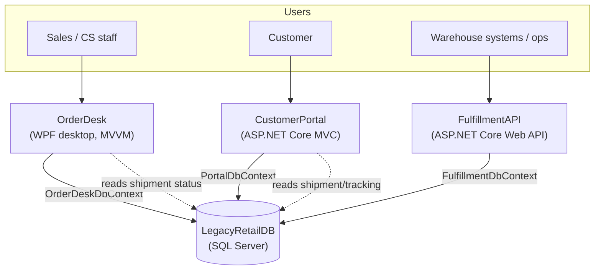
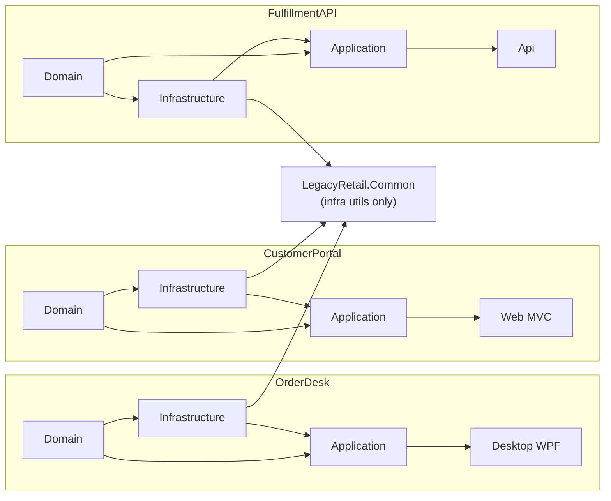
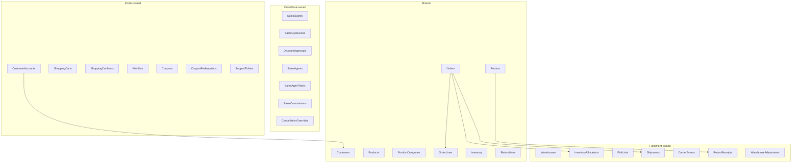
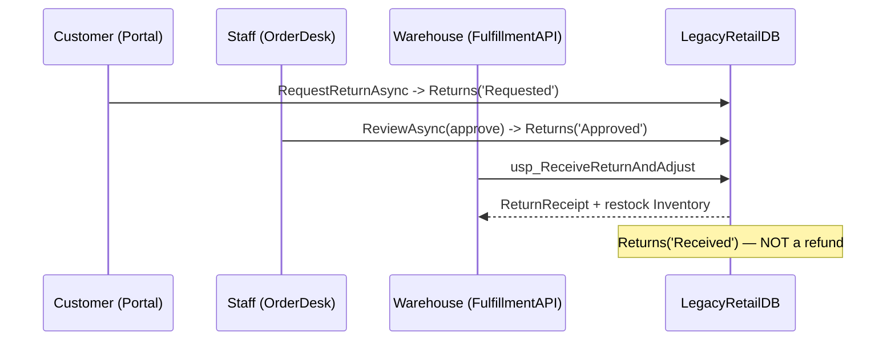
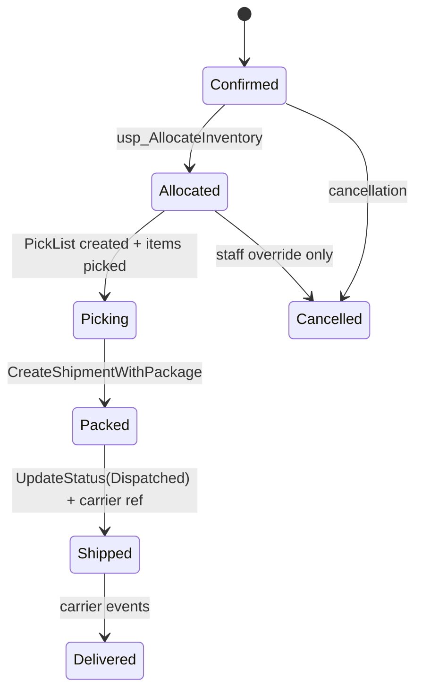

# LegacyRetailPortfolio — Architecture

Three independently developed .NET 10 applications over one shared SQL Server
database (`LegacyRetailDB`). Each application owns its domain model, DbContext,
services, and business rules. Only infrastructure utilities are shared.

## System context

## Per-application layering

## Shared database — table ownership

## Cross-application return workflow (Workflow C)

## Warehouse fulfillment (Workflow E)

## Key design decisions
- **No shared domain library.** Each app re-declares overlapping concepts (Customer,
  Order) with its own shape. See `benchmark/ground-truth/domain-entities.yaml`.
- **Rules split between SQL and C#** intentionally (e.g. staff cancellation in a stored
  procedure, customer cancellation in a C# rule) to create realistic divergence.
- **DbProvisioner owns schema**; applications never run migrations at runtime.
- **Idempotency** on checkout (idempotency key + filtered unique index), carrier events
  (unique key), and return receipts (one-per-return guard).
